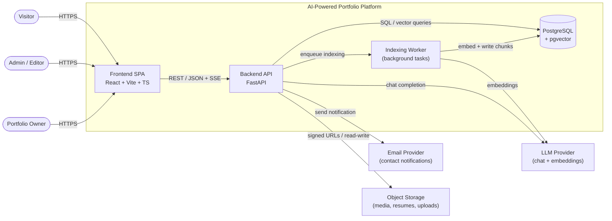
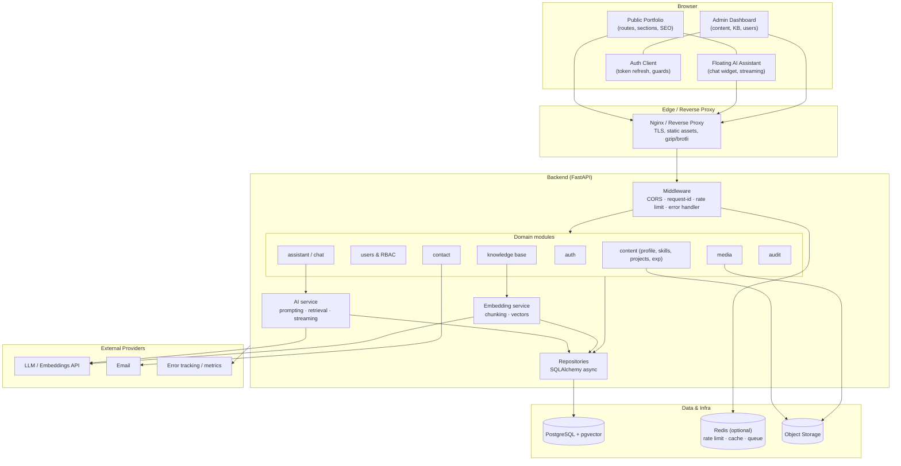
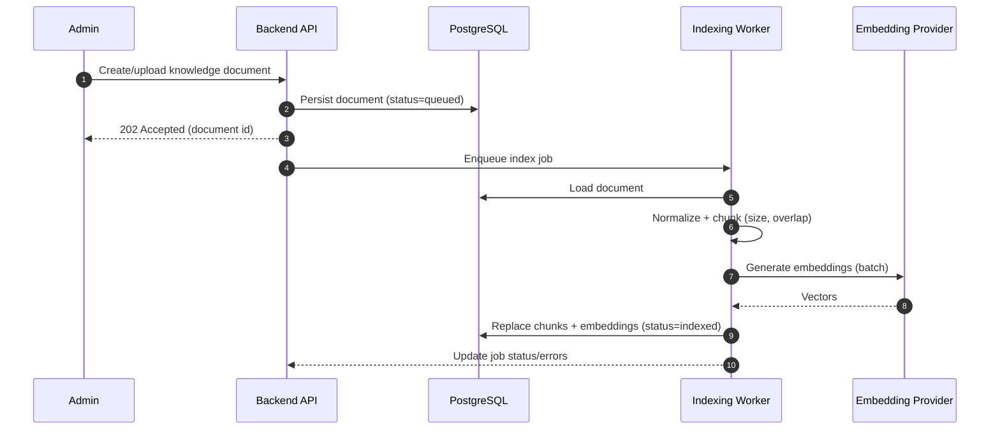
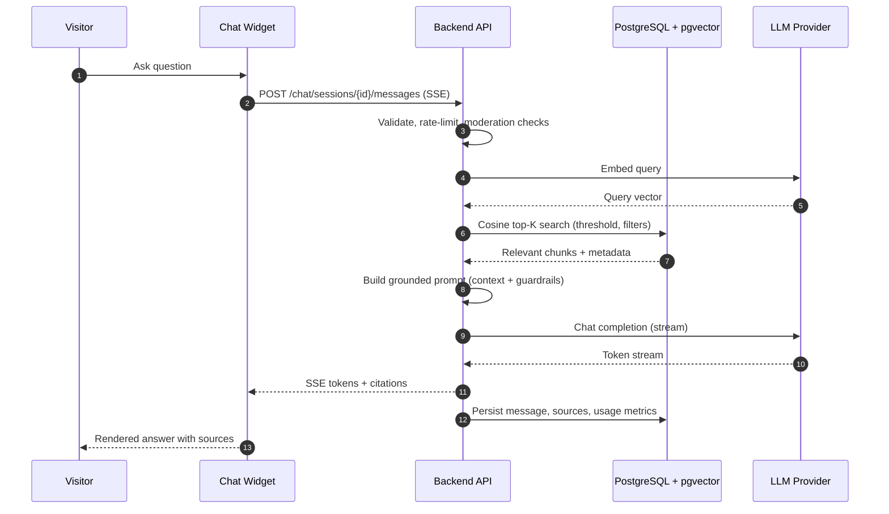
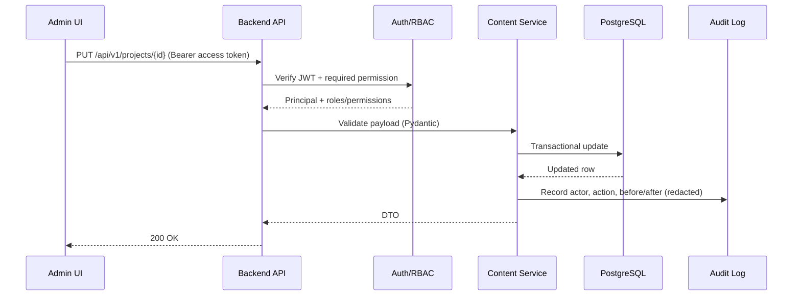
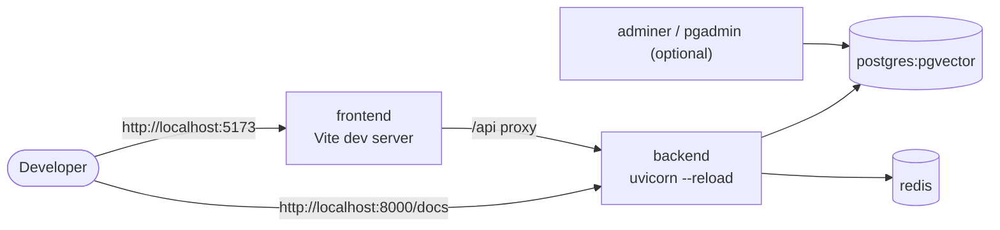
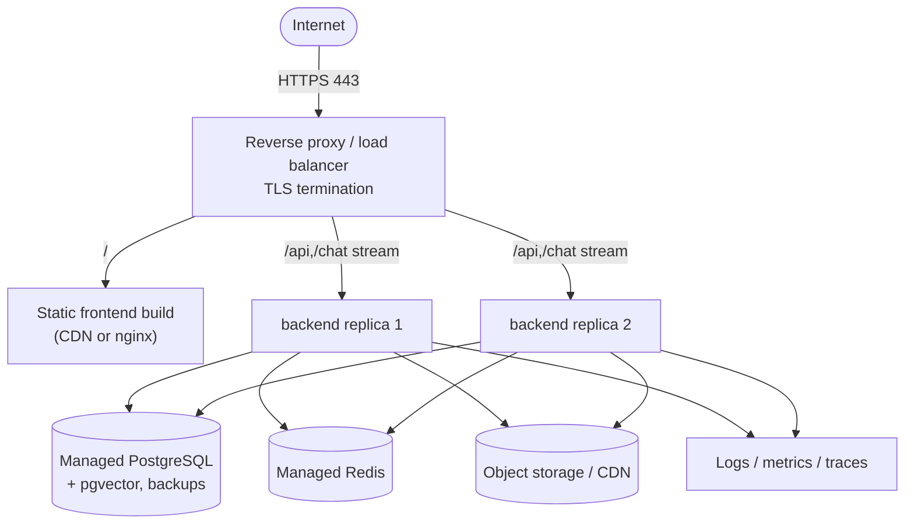

# System Architecture

**Project:** AI-Powered Developer Portfolio
**Document status:** Draft v0.1 — Phase 1
**Last updated:** 2026-11-11

---

## 1. Architectural goals

1. **Separation of concerns** — a static-first public UI, an API layer, an async AI/RAG
   pipeline, and a relational/vector data layer.
2. **Graceful degradation** — the portfolio must render and be usable even if the LLM provider
   or vector search is down.
3. **Security by default** — closed admin surface, least-privilege RBAC, strict input and
   secret handling.
4. **Operability** — one-command local environment, containerized deployables, observable
   services.
5. **Evolvability** — provider-agnostic LLM/embeddings, versioned migrations, ADR-driven
   decisions.

---

## 2. Architecture style

- **Modular monolith** backend (FastAPI) organized by domain modules, with clearly separated
  layers: API → Services → Repositories → Models.
- **SPA frontend** (React + Vite + TypeScript) with two routing surfaces: public and admin.
- **Async post-processing** for embedding/indexing via background tasks (in-process worker for
  MVP; queue-ready interface for later scaling).
- **PostgreSQL as the single source of truth**, including vector storage via `pgvector`.
- **Stateless API instances** (JWT access tokens) so the backend can scale horizontally.

Why a modular monolith over microservices for MVP: a single portfolio has low, bursty traffic;
a monolith minimizes operational cost and cross-service failure modes while remaining internally
modular enough to split the AI pipeline out later if needed. See ADR-001 (planned).

---

## 3. System context

---

## 4. Container / component diagram

---

## 5. AI / RAG pipeline

### 5.1 Ingestion (write path)

### 5.2 Retrieval + answer (read path)

**Grounding rules**

- If retrieval yields no chunk above the similarity threshold, return a safe "I don't have that
  information" response; do not call the LLM with an empty context (configurable exception for
  small-talk with a strict system prompt).
- Every answer must include at least one source when factual claims are made.
- Retrieved content is treated as **data, not instructions** (prompt-injection defense).
- Context window is bounded; top-K and token budget are configurable.

---

## 6. Request lifecycle (admin write example)

---

## 7. Layer responsibilities

| Layer | Responsibility | Must not |
|-------|----------------|----------|
| Routers (API) | HTTP concerns, dependency injection, status codes, OpenAPI metadata | Contain business logic or direct SQL |
| Services | Business rules, authorization checks, transactions, orchestration | Know about HTTP details |
| Repositories | Data access, query composition, persistence | Enforce business rules |
| Models | SQLAlchemy ORM definitions + DB constraints | Contain transport logic |
| Schemas | Pydantic request/response contracts, validation | Contain persistence logic |
| Workers | Async ingestion/embedding, retries, idempotency | Mutate unrelated domains |
| AI service | Retrieval, prompt construction, provider abstraction | Access DB outside repositories |

---

## 8. Deployment topology

### 8.1 Local / development (Docker Compose)

### 8.2 Production (baseline)

**Notes**

- SSE requires proxy buffering disabled for `/api/v1/chat/*` and appropriate timeouts.
- Embedding/indexing either runs in a dedicated worker process/container or as a separate
  service; the interface is queue-based to allow extraction later.
- The static frontend is immutable-build + long cache; API is versioned under `/api/v1`.

---

## 9. Technology decisions

| Concern | Choice | Rationale |
|---------|--------|-----------|
| Frontend | React + Vite + TypeScript | Fast DX, typed contracts, simple SPA hosting. |
| Backend | Python + FastAPI | Async I/O, OpenAPI-first, strong typing with Pydantic. |
| ORM | SQLAlchemy 2.x (async) + Alembic | Mature, migration-friendly, async support. |
| Database | PostgreSQL 15+ | Reliable relational model + pgvector in one store. |
| Vectors | pgvector | Avoids a second datastore at MVP scale. |
| Auth | JWT access + rotating refresh cookie | Stateless API, revocable sessions. |
| Hashing | Argon2id | Memory-hard, modern default. |
| Streaming | Server-Sent Events | Simple over HTTP, proxy-friendly, good browser support. |
| Containers | Docker + Compose | Reproducible dev and deployable images. |
| Config | Environment variables + `.env` (never committed) | Twelve-factor friendly. |

---

## 10. Cross-cutting concerns

- **Configuration**: single typed settings object (`pydantic-settings`), validated at startup,
  fail-fast on missing required secrets.
- **Errors**: consistent error envelope (`code`, `message`, `details`, `request_id`); no stack
  traces or secrets leaked to clients.
- **IDs**: UUIDv7 (time-ordered) for primary keys to aid indexing.
- **Concurrency**: optimistic concurrency via `updated_at`/version where editing collisions
  matter (admin content).
- **Time**: store UTC (`timestamptz`); render in client timezone.
- **Caching**: HTTP cache headers for public read endpoints; optional Redis caching for
  expensive aggregate queries.
- **Rate limiting**: per-IP for public endpoints, per-session for AI, per-account for auth.
- **Observability**: request IDs propagated FE→BE→logs; metrics for latency, error rate, LLM
  tokens/cost; health/readiness separate from liveness.

---

## 11. Risks and mitigations

| Risk | Impact | Mitigation |
|------|--------|-----------|
| LLM hallucination | Reputation/incorrect info | Strict grounding, citations, refusal path, eval set. |
| Prompt injection via KB/docs | Data leak or misuse | Treat retrieved text as data, sanitize, allowlist tools, no secrets in context. |
| Provider outage / rate limits | Assistant unavailable | Timeouts, retries, fallback message, provider abstraction. |
| Cost overrun | Budget | Token budgets, per-session limits, caching, usage metrics, budget alerts. |
| Vector table growth | Slow queries | Index strategy (HNSW/IVFFlat), chunk pruning, re-index lifecycle. |
| Admin credential compromise | Full content control | Argon2, lockout, rotation, audit, MFA (Phase 2 candidate). |
| SEO with SPA | Poor indexing | Metadata/prerender strategy, sitemap, semantic HTML. |
| Contact form abuse | Spam | Rate limit, honeypot/CAPTCHA option, server-side validation. |

---

## 12. Future evolution (post-MVP)

- Extract AI/RAG into a dedicated service if load or model diversity grows.
- Add MFA (TOTP/WebAuthn) for admins.
- Queue-backed worker (Celery/RQ/Arq) for robust indexing and retries.
- Content versioning/history and scheduled publishing.
- Multi-language portfolio and assistant.
- Analytics dashboard for assistant quality (feedback thumbs, evaluation scores).
- CDN/edge rendering for SEO-critical routes.
