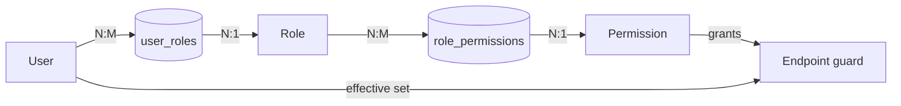
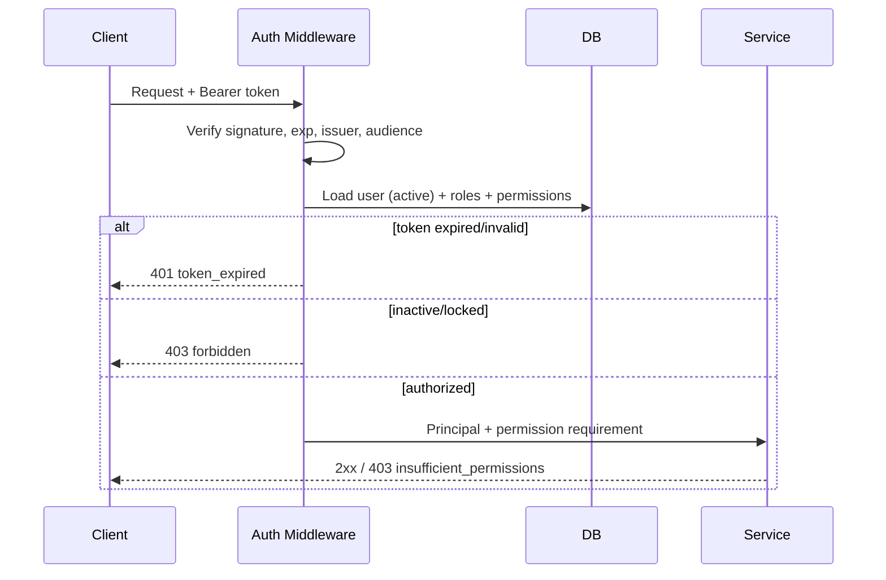
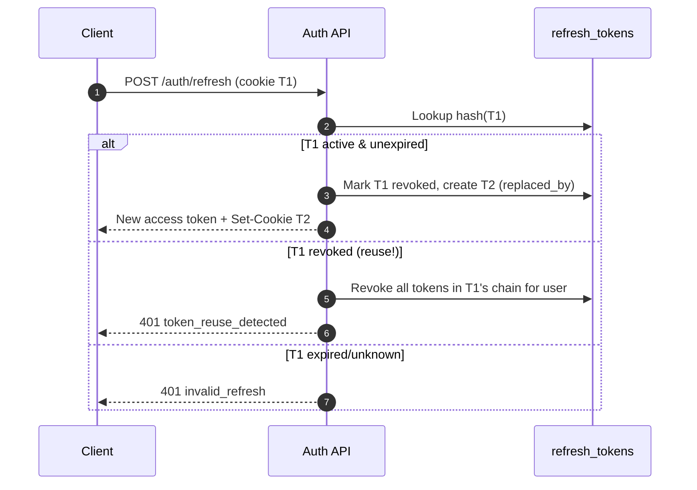

# Authentication & RBAC Design

**Project:** AI-Powered Developer Portfolio
**Document status:** Draft v0.1 — Phase 1
**Last updated:** 2026-11-11

---

## 1. Goals

- A closed admin surface: **no public registration**. Admins are provisioned by a super-admin
  or a bootstrap process.
- Stateless, horizontally scalable API authentication.
- Revocable sessions with refresh-token rotation and reuse detection.
- Least-privilege authorization using roles mapped to fine-grained permissions.
- Auditable privileged actions.
- Public endpoints (portfolio reads, contact, assistant) require no user account but are
  rate-limited and abuse-resistant.

---

## 2. Identity model

| Principal | How identified | Access |
|-----------|----------------|--------|
| Visitor | Anonymous | Public reads, contact, assistant (rate-limited). |
| Admin user | Account + session | Admin dashboard, scoped by role/permission. |
| Super admin | Account + `super_admin` role | Full access incl. user/role management. |
| System | Internal job/service identity | Migrations, indexing, maintenance. |

There is no public sign-up, password reset-by-email for visitors, or social login in MVP.
Password reset for admins is an admin-assisted flow (see §7).

---

## 3. Permission catalog

Permissions follow `resource:action`. Seed set:

| Domain | Permissions |
|--------|-------------|
| Profile/content | `profile:read`, `profile:write`, `content:read`, `content:write` |
| Skills | `skill:read`, `skill:write` |
| Projects | `project:read`, `project:write` |
| Media | `media:read`, `media:write` |
| Knowledge | `knowledge:read`, `knowledge:write`, `knowledge:reindex` |
| Chat | `chat:read`, `chat:moderate` |
| Contact | `contact:read`, `contact:manage` |
| Users | `user:read`, `user:write` |
| Roles | `role:read`, `role:assign` |
| Settings | `settings:read`, `settings:write` |
| Audit | `audit:read` |

The permission list is seeded by migration/seed script and is the single source of truth.

---

## 4. Role definitions

| Role | Intent | Permissions (baseline) |
|------|--------|------------------------|
| `super_admin` | Full control, user/role management | All permissions + implicit superuser flag. |
| `admin` | Manage content, KB, settings, users (except super-admin grants) | All except `role:assign` of super-admin; no user deletion of super-admin. |
| `editor` | Create/edit/publish content and knowledge docs | `profile:*`, `content:*`, `skill:*`, `project:*`, `media:*`, `knowledge:read/write/reindex`, `contact:read` |
| `viewer` | Read-only dashboards | `*:read` (no write/manage), `audit:read` |

Rules:

- Only `super_admin` may grant or revoke the `super_admin` role (FR-ADM-08/FR-ADM-12).
- The system must always retain at least one active `super_admin`; operations that would
  violate this return `409 last_super_admin`.
- A user may hold multiple roles; effective permissions are the **union**.
- `is_superuser` on the user record is a hard override used only for bootstrap; it must be
  reconciled with the `super_admin` role and audited.

---

## 5. Authorization model



- Authorization is enforced **server-side** on every protected route via a dependency that
  loads the principal and checks the required permission(s).
- Frontend route guards are UX-only; they never substitute for server checks.
- Deny by default: an endpoint without an explicit public marker requires authentication.
- Object-level checks (e.g., cannot modify another user's session/transcript) are enforced in
  services, not just routers.

### 5.1 Permission check flow



---

## 6. Token design

### 6.1 Access token (JWT)

| Property | Value |
|----------|-------|
| Type | JWT, signed (HS256 dev, RS256/EdDSA prod recommended) |
| Lifetime | 15 minutes (configurable) |
| Storage (client) | In memory only (never localStorage) |
| Claims | `sub` (user id), `jti`, `iat`, `exp`, `iss`, `aud`, `roles`, `perms` (optional), `ver` (token version) |
| Transport | `Authorization: Bearer <token>` |
| Revocation | Short TTL + `ver`/`token_version` claim checked against the user record; global logout increments version |

Access tokens are **not** stored server-side. To invalidate immediately (e.g., password change,
role change, deactivation), increment `users.token_version`; middleware rejects tokens whose
`ver` is stale.

### 6.2 Refresh token

| Property | Value |
|----------|-------|
| Type | Opaque random (256-bit), stored **hashed** (SHA-256) in `refresh_tokens` |
| Lifetime | 7 days (configurable), sliding via rotation |
| Storage (client) | `HttpOnly; Secure; SameSite=Lax` (or `Strict`) cookie scoped to `/api/v1/auth` |
| Rotation | Every refresh issues a new token; the old one is revoked and linked via `replaced_by_id` |
| Reuse detection | Presenting a revoked/used token revokes the entire descendant chain and logs a security event |

Cookie attributes:

```
Set-Cookie: refresh_token=<opaque>; HttpOnly; Secure; SameSite=Lax; Path=/api/v1/auth; Max-Age=604800
```

`SameSite=Lax` supports top-level navigation while blocking most CSRF. If the SPA and API are
cross-site, use `SameSite=None; Secure` plus CSRF tokens and strict CORS.

### 6.3 Rotation & reuse detection



### 6.4 Logout

- `POST /auth/logout`: revoke current refresh token, clear cookie, `204`.
- "Logout everywhere": revoke all user refresh tokens + increment `token_version`.

---

## 7. Authentication flows

### 7.1 Login

1. Normalize email, look up user.
2. If account locked (`locked_until > now`) → `429`/`403`.
3. Verify Argon2id hash (constant-time; dummy verify on unknown user to avoid enumeration).
4. On failure: increment `failed_login_count`; lock after threshold (default 5 for 15 min).
5. On success: reset counters, set `last_login_at`, create refresh token, issue access token.
6. Audit `auth.login` (success/failure with reason, IP, user agent).
7. Return access token + set refresh cookie.

### 7.2 Session validation

- Verify JWT signature/claims (`exp`, `iss`, `aud`).
- Load user; reject inactive/locked.
- Reject if token `ver` != `users.token_version`.
- Attach principal (id, roles, effective permissions).

### 7.3 Bootstrap super-admin

- A CLI/management command (e.g., `python -m app.cli create-superadmin`) or a one-time
  idempotent startup seed driven by env vars (`BOOTSTRAP_ADMIN_EMAIL`,
  `BOOTSTRAP_ADMIN_PASSWORD`).
- Never expose a public bootstrap endpoint.
- Force password change on first login (`must_change_password` flag).
- Refuse to run if a super-admin already exists (idempotent).

### 7.4 Password policy & storage

- Argon2id with tuned parameters (memory ≥ 64 MiB, iterations ≥ 3, parallelism ≥ 1); upgrade
  parameters over time and re-hash on successful login when needed.
- Minimum 12 chars, reject breached/common passwords (optional offline list), allow passphrases,
  no forced composition rules beyond length/entropy.
- Password reset is admin-assisted: an admin triggers a time-limited reset token delivered out
  of band; user must change on next login. No public reset endpoint in MVP.

### 7.5 Account lockout

- Track `failed_login_count`, `locked_until`.
- Default: 5 failures → 15-minute lock; exponential backoff for repeated locks.
- Lockout responses must not reveal whether the email exists.
- Security event logged; optional email notification to the owner.

---

## 8. CSRF & cookie strategy

- Because refresh uses cookies, sensitive state-changing requests must be CSRF-safe:
  - Prefer `SameSite=Lax/Strict`.
  - Alternatively/additionally, require a double-submit CSRF token for cookie-authenticated
    routes.
- Access-token-protected APIs use the `Authorization` header, which is not automatically
  attached by browsers, limiting CSRF exposure.
- CORS: explicit allowlist of the frontend origin(s); `credentials: true` only for those
  origins; never `*` with credentials.

---

## 9. Threat model (auth-specific)

| Threat | Mitigation |
|--------|-----------|
| Credential stuffing / brute force | Rate limits, lockout/backoff, breached-password checks, generic errors. |
| User enumeration | Constant-time dummy verify, uniform responses, same timing. |
| Token theft (XSS) | Access token in memory; refresh in HttpOnly cookie; strict CSP. |
| Refresh token theft | Rotation + reuse detection, hashed storage, scoped path, short-ish TTL. |
| CSRF | SameSite + CSRF token + CORS allowlist. |
| Privilege escalation | Server-side permission checks, deny-by-default, super-admin grant restricted. |
| Last-admin lockout | Prevent demotion/deletion of last active super-admin. |
| Session fixation | New refresh token on login; never accept client-supplied session ids blindly. |
| JWT algorithm confusion | Pin algorithm, verify `iss`/`aud`, reject `none`. |
| Logout not effective | `token_version` increment for global logout. |
| Audit tampering | Append-only table, restricted DB role, no update/delete API. |

---

## 10. Audit events

Minimum events (redact secrets/PII):

| Action | Payload (redacted) |
|--------|--------------------|
| `auth.login.success` / `auth.login.failure` | user id/email, IP, UA, reason |
| `auth.logout` / `auth.logout_all` | user id |
| `auth.refresh.reuse_detected` | user id, token id, IP |
| `auth.password.change` | user id |
| `user.create` / `user.update` / `user.deactivate` | actor, target, changed fields |
| `role.assign` / `role.revoke` | actor, target, roles |
| `content.*` mutations | actor, entity, before/after diff |
| `knowledge.reindex` | actor, scope |
| `settings.update` | actor, changed keys |

Audit writes happen in the same transaction as the privileged mutation where feasible.

---

## 11. Authorization matrix (summary)

| Capability | Visitor | Viewer | Editor | Admin | Super Admin |
|------------|:-------:|:------:|:------:|:-----:|:-----------:|
| View public portfolio | ✅ | ✅ | ✅ | ✅ | ✅ |
| Use assistant | ✅ | ✅ | ✅ | ✅ | ✅ |
| Submit contact form | ✅ | ✅ | ✅ | ✅ | ✅ |
| Read admin dashboards | ❌ | ✅ | ✅ | ✅ | ✅ |
| Edit profile/content | ❌ | ❌ | ✅ | ✅ | ✅ |
| Manage projects/skills | ❌ | ❌ | ✅ | ✅ | ✅ |
| Manage knowledge base | ❌ | ❌ | ✅ | ✅ | ✅ |
| Read contact messages | ❌ | ✅ | ✅ | ✅ | ✅ |
| Manage users | ❌ | ❌ | ❌ | ✅ | ✅ |
| Assign roles (non-super) | ❌ | ❌ | ❌ | ✅ | ✅ |
| Assign `super_admin` | ❌ | ❌ | ❌ | ❌ | ✅ |
| Update settings | ❌ | ❌ | ❌ | ✅ | ✅ |
| Read audit logs | ❌ | ✅ | ❌ | ✅ | ✅ |

✅ = allowed; ❌ = denied. Final matrix is encoded in seed data + endpoint guards and verified by
authorization tests.

---

## 12. Frontend auth behavior

- On app load: attempt a silent refresh (cookie) once to restore session.
- Hold access token in memory; on `401 token_expired`, refresh once and retry the request;
  on repeated failure, clear state and redirect to `/admin/login`.
- Route guards check session presence + roles for UX; server remains authoritative.
- Display role/permission-aware UI (hide actions), never rely on it for security.
- Logout clears in-memory token and calls `/auth/logout`.

---

## 13. Configuration

| Variable | Purpose |
|----------|---------|
| `JWT_SECRET` / `JWT_PRIVATE_KEY` | Signing key material (never committed). |
| `JWT_ALGORITHM` | e.g., `HS256` (dev) / `RS256` (prod). |
| `JWT_ISSUER`, `JWT_AUDIENCE` | Claim validation. |
| `ACCESS_TOKEN_TTL_SECONDS` | Default 900. |
| `REFRESH_TOKEN_TTL_SECONDS` | Default 604800. |
| `REFRESH_COOKIE_SECURE`, `REFRESH_COOKIE_SAMESITE` | Cookie policy. |
| `CORS_ORIGINS` | Allowlist. |
| `LOCKOUT_THRESHOLD`, `LOCKOUT_DURATION_SECONDS` | Lockout policy. |
| `BOOTSTRAP_ADMIN_EMAIL` / `BOOTSTRAP_ADMIN_PASSWORD` | One-time super-admin seed. |

---

## 14. Open auth questions

See [`open-questions.md`](./open-questions.md). Notable: required MFA in MVP, hosting
topology (same-site vs cross-site SPA/API), and whether `viewer` role is needed at launch.
