# Database Design

**Project:** AI-Powered Developer Portfolio
**Database:** PostgreSQL 15+ with `pgvector`
**Document status:** Draft v0.1 — Phase 1
**Last updated:** 2026-11-11

---

## 1. Design principles

- **Single source of truth**: PostgreSQL stores relational content *and* vector embeddings.
- **UUIDv7 primary keys** (time-ordered) for distributed-friendly IDs and index locality.
- **`timestamptz` UTC everywhere**; timestamps generated server-side.
- **Soft deletes** (`deleted_at`) for content that must be recoverable; hard deletes for
  ephemeral data (sessions, tokens).
- **Referential integrity** enforced with FK constraints and explicit `ON DELETE` behavior.
- **Migrations only** via Alembic; schema never edited by hand.
- **Enums**: prefer lookup tables for RBAC (roles/permissions) and PostgreSQL enums or
  `CHECK` constraints for small fixed states (e.g., publish status).
- **Embeddings are versioned** by model so re-indexing is detectable.

---

## 2. Conventions

| Concern | Convention |
|---------|-----------|
| Table names | `snake_case`, plural (`projects`, `knowledge_documents`). |
| PK | `id uuid` default `gen_random_uuid()` (or app-generated UUIDv7). |
| FKs | `<entity>_id`; indexed automatically when used in joins. |
| Timestamps | `created_at`, `updated_at` (`timestamptz NOT NULL DEFAULT now()`). |
| Soft delete | `deleted_at timestamptz NULL`; partial indexes exclude deleted rows. |
| Money/counts | `integer`/`bigint`, never floats for money. |
| Slugs | `text`, unique, URL-safe, immutable once published (redirect map later). |
| JSON | `jsonb` with validated shape; not a substitute for real columns. |

---

## 3. Entity-relationship diagram

> Vector columns are shown as `vector`; dimensions are fixed by the chosen embedding model
> (default 1536). Change only behind a migration + full re-index.

```mermaid
erDiagram
    USERS {
        uuid id PK
        citext email UK
        text password_hash
        text full_name
        boolean is_active
        boolean is_superuser
        integer failed_login_count
        timestamptz locked_until
        timestamptz last_login_at
        timestamptz created_at
        timestamptz updated_at
    }

    ROLES {
        uuid id PK
        text name UK
        text description
        timestamptz created_at
    }

    PERMISSIONS {
        uuid id PK
        text code UK
        text description
    }

    USER_ROLES {
        uuid user_id PK,FK
        uuid role_id PK,FK
    }

    ROLE_PERMISSIONS {
        uuid role_id PK,FK
        uuid permission_id PK,FK
    }

    REFRESH_TOKENS {
        uuid id PK
        uuid user_id FK
        text token_hash UK
        text user_agent
        inet ip_address
        timestamptz expires_at
        timestamptz revoked_at
        uuid replaced_by_id FK
        timestamptz created_at
    }

    PROFILES {
        uuid id PK
        text display_name
        text headline
        text bio
        text location
        text availability
        uuid avatar_media_id FK
        uuid resume_media_id FK
        jsonb meta
        timestamptz updated_at
    }

    SOCIAL_LINKS {
        uuid id PK
        uuid profile_id FK
        text label
        text url
        text icon
        integer sort_order
    }

    SKILL_CATEGORIES {
        uuid id PK
        text name UK
        integer sort_order
    }

    SKILLS {
        uuid id PK
        uuid category_id FK
        text name
        integer proficiency
        integer sort_order
        boolean is_published
        timestamptz created_at
        timestamptz updated_at
    }

    PROJECTS {
        uuid id PK
        text slug UK
        text title
        text summary
        text description
        text status
        text repo_url
        text live_url
        uuid cover_media_id FK
        boolean is_featured
        boolean is_published
        integer sort_order
        date started_on
        date ended_on
        timestamptz created_at
        timestamptz updated_at
        timestamptz deleted_at
    }

    TAGS {
        uuid id PK
        text slug UK
        text name
    }

    PROJECT_TAGS {
        uuid project_id PK,FK
        uuid tag_id PK,FK
    }

    PROJECT_SKILLS {
        uuid project_id PK,FK
        uuid skill_id PK,FK
    }

    EXPERIENCES {
        uuid id PK
        text company
        text title
        text location
        text description
        date started_on
        date ended_on
        boolean is_current
        integer sort_order
        boolean is_published
    }

    EDUCATION {
        uuid id PK
        text institution
        text degree
        text field_of_study
        text description
        date started_on
        date ended_on
        integer sort_order
        boolean is_published
    }

    MEDIA_ASSETS {
        uuid id PK
        text storage_key UK
        text original_name
        text mime_type
        bigint size_bytes
        integer width
        integer height
        uuid uploaded_by_id FK
        timestamptz created_at
    }

    KNOWLEDGE_DOCUMENTS {
        uuid id PK
        text title
        text source_type
        text source_ref
        text content
        text checksum
        text status
        text tags
        text embedding_model
        integer chunk_count
        text last_error
        uuid created_by_id FK
        timestamptz indexed_at
        timestamptz created_at
        timestamptz updated_at
        timestamptz deleted_at
    }

    KNOWLEDGE_CHUNKS {
        uuid id PK
        uuid document_id FK
        integer chunk_index
        text content
        integer token_count
        vector embedding
        text embedding_model
        text metadata
        timestamptz created_at
    }

    CHAT_SESSIONS {
        uuid id PK
        text session_token UK
        inet ip_address
        text user_agent
        text status
        timestamptz last_active_at
        timestamptz created_at
    }

    CHAT_MESSAGES {
        uuid id PK
        uuid session_id FK
        text role
        text content
        text refusal_reason
        jsonb sources
        integer prompt_tokens
        integer completion_tokens
        integer latency_ms
        timestamptz created_at
    }

    CONTACT_MESSAGES {
        uuid id PK
        text name
        citext email
        text subject
        text message
        text status
        inet ip_address
        timestamptz created_at
        timestamptz read_at
    }

    AUDIT_LOGS {
        uuid id PK
        uuid actor_user_id FK
        text action
        text entity_type
        uuid entity_id
        jsonb diff
        inet ip_address
        text request_id
        timestamptz created_at
    }

    SITE_SETTINGS {
        text key PK
        jsonb value
        timestamptz updated_at
    }

    USERS ||--o{ USER_ROLES : assigned
    ROLES ||--o{ USER_ROLES : grants
    ROLES ||--o{ ROLE_PERMISSIONS : contains
    PERMISSIONS ||--o{ ROLE_PERMISSIONS : included_in
    USERS ||--o{ REFRESH_TOKENS : owns
    USERS ||--o| PROFILES : has
    PROFILES ||--o{ SOCIAL_LINKS : lists
    SKILL_CATEGORIES ||--o{ SKILLS : groups
    SKILLS ||--o{ PROJECT_SKILLS : used_in
    PROJECTS ||--o{ PROJECT_SKILLS : uses
    PROJECTS ||--o{ PROJECT_TAGS : tagged
    TAGS ||--o{ PROJECT_TAGS : labels
    MEDIA_ASSETS ||--o{ PROFILES : avatar_or_resume
    MEDIA_ASSETS ||--o{ PROJECTS : cover
    USERS ||--o{ KNOWLEDGE_DOCUMENTS : authors
    KNOWLEDGE_DOCUMENTS ||--o{ KNOWLEDGE_CHUNKS : splits_into
    CHAT_SESSIONS ||--o{ CHAT_MESSAGES : contains
    USERS ||--o{ MEDIA_ASSETS : uploads
    USERS ||--o{ AUDIT_LOGS : performs
```



> Rendering note: Mermaid ER attribute lists are illustrative. The authoritative column
> definitions, types, and constraints are in §5.

---

## 4. Tables overview

| Domain | Tables |
|--------|--------|
| Identity & access | `users`, `roles`, `permissions`, `user_roles`, `role_permissions`, `refresh_tokens` |
| Portfolio content | `profiles`, `social_links`, `skill_categories`, `skills`, `projects`, `tags`, `project_tags`, `project_skills`, `experiences`, `education` |
| Media | `media_assets` |
| AI knowledge base | `knowledge_documents`, `knowledge_chunks` |
| Assistant | `chat_sessions`, `chat_messages` |
| Engagement | `contact_messages` |
| Platform | `audit_logs`, `site_settings` |

---

## 5. Table specifications

### 5.1 `users`

| Column | Type | Constraints |
|--------|------|-------------|
| `id` | `uuid` | PK, default app UUIDv7 |
| `email` | `citext` | NOT NULL, UNIQUE |
| `password_hash` | `text` | NOT NULL |
| `full_name` | `text` | NOT NULL |
| `is_active` | `boolean` | NOT NULL DEFAULT true |
| `is_superuser` | `boolean` | NOT NULL DEFAULT false |
| `failed_login_count` | `integer` | NOT NULL DEFAULT 0 |
| `locked_until` | `timestamptz` | NULL |
| `last_login_at` | `timestamptz` | NULL |
| `created_at`, `updated_at` | `timestamptz` | NOT NULL DEFAULT now() |

Indexes: unique `email`; partial index on `is_active` where true.

### 5.2 `roles` / `permissions` / join tables

- `roles(name)` unique; seeded: `super_admin`, `admin`, `editor`, `viewer`.
- `permissions(code)` unique; seeded with `resource:action` codes (see
  [`authentication-rbac.md`](./authentication-rbac.md) §3).
- `user_roles(user_id, role_id)` composite PK, FKs `ON DELETE CASCADE`.
- `role_permissions(role_id, permission_id)` composite PK, FKs `ON DELETE CASCADE`.

### 5.3 `refresh_tokens`

| Column | Type | Notes |
|--------|------|-------|
| `id` | `uuid` | PK (also JWT `jti`) |
| `user_id` | `uuid` | FK → users, `ON DELETE CASCADE` |
| `token_hash` | `text` | UNIQUE; SHA-256 of token, never store raw |
| `user_agent` | `text` | Optional, for session display |
| `ip_address` | `inet` | Optional |
| `expires_at` | `timestamptz` | NOT NULL |
| `revoked_at` | `timestamptz` | NULL |
| `replaced_by_id` | `uuid` | FK → refresh_tokens (rotation chain) |
| `created_at` | `timestamptz` | NOT NULL DEFAULT now() |

Indexes: `user_id`, `expires_at`, partial index on active tokens.

### 5.4 Content tables

**`profiles`** — singleton row (`id` fixed or single-row constraint). Holds display name,
headline, bio, location, availability, references to avatar/resume media, and flexible `meta`
JSONB (e.g., open-to-work flags, pronouns).

**`social_links`** — `profile_id`, `label`, `url`, `icon`, `sort_order`. Validate URL schemes
(`http`, `https`, `mailto`).

**`skill_categories`** — `name` unique, `sort_order`.

**`skills`** — `category_id` FK, `name`, `proficiency` (0–100, `CHECK`), `sort_order`,
`is_published`. Unique `(category_id, name)`.

**`projects`** — `slug` unique, `title`, `summary`, `description` (markdown), `status`,
`repo_url`, `live_url`, `cover_media_id`, `is_featured`, `is_published`, `sort_order`,
`started_on`, `ended_on`, soft delete `deleted_at`. Indexes on `is_published`, `is_featured`,
`slug`; partial indexes exclude deleted/deactivated rows.

**`tags`** — `slug` unique, `name`.

**`project_tags`** — composite PK (`project_id`, `tag_id`), FKs `CASCADE`.

**`project_skills`** — composite PK (`project_id`, `skill_id`), FKs `CASCADE`.

**`experiences`** — `company`, `title`, `location`, `description`, dates, `is_current`,
`sort_order`, `is_published`.

**`education`** — `institution`, `degree`, `field_of_study`, `description`, dates,
`sort_order`, `is_published`.

### 5.5 `media_assets`

`storage_key` unique (object storage path), `original_name`, `mime_type`, `size_bytes`,
optional `width`/`height`, `uploaded_by_id`. Enforce allowed MIME types at the service layer
and size limits at the proxy/API boundary. Store binaries in object storage, never in Postgres.

### 5.6 `knowledge_documents`

| Column | Type | Notes |
|--------|------|-------|
| `id` | `uuid` | PK |
| `title` | `text` | NOT NULL |
| `source_type` | `text` | `manual`, `file`, `url` |
| `source_ref` | `text` | Original filename/URL (nullable) |
| `content` | `text` | Normalized text/markdown |
| `checksum` | `text` | SHA-256 to detect changes / dedupe |
| `status` | `text` | `queued`, `indexing`, `indexed`, `failed`, `stale` |
| `tags` | `text[]` | Metadata filters for retrieval |
| `embedding_model` | `text` | Model used for last index |
| `chunk_count` | `integer` | Denormalized count |
| `last_error` | `text` | Redacted error summary |
| `created_by_id` | `uuid` | FK → users |
| `indexed_at` | `timestamptz` | Last successful index |
| `deleted_at` | `timestamptz` | Soft delete stops retrieval |

Indexes: unique `checksum` (dedupe optional), GIN on `tags`, status partial index.

### 5.7 `knowledge_chunks`

| Column | Type | Notes |
|--------|------|-------|
| `id` | `uuid` | PK |
| `document_id` | `uuid` | FK → knowledge_documents, `ON DELETE CASCADE` |
| `chunk_index` | `integer` | Order within document; unique `(document_id, chunk_index)` |
| `content` | `text` | Chunk text |
| `token_count` | `integer` | For budgeting |
| `embedding` | `vector(1536)` | Model-dependent dimension |
| `embedding_model` | `text` | Version tag; matches document |
| `metadata` | `jsonb` | Heading/path/section info |
| `created_at` | `timestamptz` | NOT NULL DEFAULT now() |

**Vector index**

```sql
-- Approximate nearest neighbor; tune lists/m per corpus size.
CREATE INDEX idx_chunks_embedding
  ON knowledge_chunks USING hnsw (embedding vector_cosine_ops);
```

Retrieval query uses `embedding <=> :query_vec` (cosine distance), filtered by document
`status = 'indexed'` and `deleted_at IS NULL`, with configurable `top_k` and threshold.

### 5.8 `chat_sessions` / `chat_messages`

- `chat_sessions`: opaque `session_token` (random, unguessable) unique; `ip_address`,
  `user_agent`, `status` (`active`, `closed`, `expired`), `last_active_at`.
- `chat_messages`: `session_id` FK `CASCADE`; `role` (`user`, `assistant`, `system`);
  `content`; `refusal_reason`; `sources jsonb` (array of document/chunk refs used);
  token counts and `latency_ms` for analytics. Index `(session_id, created_at)`.
- Retention: configurable TTL; purge/archive job (see security doc).

### 5.9 `contact_messages`

`name`, `email`, `subject`, `message`, `status` (`new`, `read`, `archived`, `spam`),
`ip_address`, `created_at`, `read_at`. Never expose full list publicly; admin only.

### 5.10 `audit_logs`

Append-only. `actor_user_id` (nullable for system), `action` (e.g., `project.update`),
`entity_type`, `entity_id`, `diff` JSONB (redact secrets/passwords), `ip_address`,
`request_id`, `created_at`. No update/delete API; retention policy via partition or archival.

### 5.11 `site_settings`

Key-value `jsonb` store for assistant configuration (model, temperature, max tokens, system
prompt, top_k), feature flags, and SEO defaults. Secrets must **not** live here.

---

## 6. Relationships summary

| Parent | Child | Cardinality | On delete |
|--------|-------|-------------|-----------|
| users | user_roles | 1:N | CASCADE |
| roles | user_roles | 1:N | CASCADE |
| roles | role_permissions | 1:N | CASCADE |
| permissions | role_permissions | 1:N | CASCADE |
| users | refresh_tokens | 1:N | CASCADE |
| users | profiles | 1:1 | CASCADE |
| profiles | social_links | 1:N | CASCADE |
| skill_categories | skills | 1:N | RESTRICT |
| projects | project_tags | 1:N | CASCADE |
| tags | project_tags | 1:N | CASCADE |
| projects | project_skills | 1:N | CASCADE |
| skills | project_skills | 1:N | CASCADE |
| users | media_assets | 1:N | SET NULL |
| users | knowledge_documents | 1:N | SET NULL |
| knowledge_documents | knowledge_chunks | 1:N | CASCADE |
| chat_sessions | chat_messages | 1:N | CASCADE |
| users | audit_logs | 1:N | SET NULL |

---

## 7. Data lifecycle & retention

| Data | Retention | Notes |
|------|-----------|-------|
| Users, roles, content | Indefinite | Soft delete where recoverability matters. |
| Refresh tokens | Until expiry/revocation + 30d audit | Hard delete after retention. |
| Chat transcripts | Configurable (default 90d) | Purge job; allow opt-out. |
| Contact messages | 12 months or until archived | May contain PII. |
| Audit logs | 12–24 months | Append-only, redacted. |
| Knowledge chunks | Until document deleted/re-indexed | Cascades from document. |
| Media | Until replaced/removed | Orphan cleanup job. |

---

## 8. Migration strategy

- Alembic autogenerate + hand review; every migration has `upgrade` and `downgrade`.
- Naming conventions configured in SQLAlchemy metadata (`ix_`, `uq_`, `fk_`, `ck_`, `pk_`).
- `citext` and `vector` extensions created in an initial migration.
- Seed script (idempotent) for permissions, roles, and the bootstrap super-admin (env-driven).
- Destructive changes require a two-step deploy (add → backfill → switch → drop).
- CI runs migrations against a fresh Postgres+pgvector container and asserts a clean schema.

---

## 9. Open data questions

See [`open-questions.md`](./open-questions.md). Key items: embedding model/dimensions,
retention windows, whether education/certifications are in MVP, and whether chat transcripts
are persisted by default.
