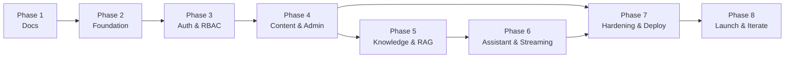

# Development Milestones

**Project:** AI-Powered Developer Portfolio
**Document status:** Draft v0.1 — Phase 1
**Last updated:** 2026-11-11

Estimates assume one full-time developer and are indicative, not commitments. Each milestone has
explicit exit criteria so "done" is testable.

---

## 0. Phase map

```mermaid
gantt
    title Indicative delivery timeline (relative weeks)
    dateFormat  X
    axisFormat  %s
    section Discovery
    Phase 1 - Architecture docs      :done, p1, 0, 1
    section Foundation
    Phase 2 - Scaffolding and local env :p2, 1, 2
    Phase 3 - Auth and RBAC          :p3, 3, 2
    section Core product
    Phase 4 - Content and admin CRUD :p4, 5, 3
    section AI
    Phase 5 - Knowledge base and RAG :p5, 8, 3
    Phase 6 - Assistant UI and streaming :p6, 11, 2
    section Launch
    Phase 7 - Hardening and deployment :p7, 13, 2
    Phase 8 - Launch and iterate     :p8, 15, 1
```

---

## Phase 1 — Architecture & documentation (current)

**Goal:** Agree on scope, architecture, data model, API, auth, security, and structure before
writing code.

**Deliverables**
- `docs/SRS.md`, `architecture.md`, `database.md`, `api.md`, `authentication-rbac.md`,
  `repository-structure.md`, `security.md`, `milestones.md`, `open-questions.md`, `README.md`.
- Mermaid diagrams render without errors.
- Open questions answered or explicitly deferred.

**Exit criteria**
- [ ] Owner approves the documentation baseline.
- [ ] Must-answer open questions resolved.
- [ ] LLM/embedding provider and hosting assumptions confirmed (or deferred with a decision date).

**Out of scope:** any application code.

---

## Phase 2 — Foundation & local environment

**Goal:** A runnable skeleton with tooling, containers, and CI.

**Deliverables**
- Frontend scaffold (Vite + React + TS), routing shell, base layout, lint/format.
- Backend scaffold (FastAPI app factory, settings, logging, error envelope, health endpoints).
- `docker-compose` with backend, frontend, `postgres:pgvector`, Redis.
- Alembic initialized; initial empty migration; extension setup.
- `.env.example` completed; config validation.
- CI: lint, typecheck, tests, build; pre-commit hooks.
- README quickstart verified on a clean machine.

**Exit criteria**
- `docker compose up` yields healthy services and `/health` returns `ok`.
- CI green on an empty test suite.
- No secrets committed; secret scan passes.

**Risks:** Docker on Windows/WSL2 performance; align volume mounts and file watching.

---

## Phase 3 — Authentication & RBAC

**Goal:** Secure admin login and the permissions backbone.

**Deliverables**
- `users`, `roles`, `permissions`, joins, `refresh_tokens` models + migrations + seed.
- Login, refresh (rotation + reuse detection), logout, `/auth/me`, change password.
- Argon2id hashing, lockout, token versioning, audit events.
- RBAC dependencies and endpoint guards; bootstrap super-admin CLI.
- Frontend login page, session bootstrap, refresh flow, route guards, RBAC-aware UI.
- Auth + authorization test suites (positive/negative).

**Exit criteria**
- All auth flows covered by automated tests (including reuse detection and lockout).
- Permission matrix enforced server-side; unauthorized access returns `403` consistently.
- Last-super-admin protection verified.
- Audit log records auth and user/role changes.

---

## Phase 4 — Content model & admin CRUD

**Goal:** Manage all portfolio content dynamically.

**Deliverables**
- Profile, social links, skill categories/skills, projects/tags, experience, education,
  media management: models, migrations, schemas, services, repositories, endpoints.
- Draft/published states, ordering, slugs, soft delete.
- Public read endpoints + caching headers.
- Admin dashboard shells: list, create, edit, delete, reorder, media upload, preview.
- Contact form (store + notify owner) with honeypot/rate limit.
- Public portfolio pages rendering live data (profile, projects list/detail, skills, timeline).
- SEO metadata, sitemap, robots, Open Graph.
- Tests: CRUD, validation, slug conflicts, authorization per role.

**Exit criteria**
- Owner can add/edit a project and see it on the public site without code changes.
- Public content works with JavaScript disabled for core text (progressive enhancement target).
- Accessibility pass (keyboard, focus, contrast) on public and admin shells.
- Authorization tests cover every content endpoint.

---

## Phase 5 — Knowledge base & RAG

**Goal:** Ingestion, embeddings, and retrieval over pgvector.

**Deliverables**
- `knowledge_documents`, `knowledge_chunks` models + migration + HNSW index.
- Chunking + embedding pipeline (provider abstraction, batching, idempotency, retries).
- Indexing worker/background job with status transitions and error capture.
- Admin KB UI: create via text/upload, list, status, reindex single/all, soft delete.
- `/knowledge/search` debug endpoint + retrieval service with configurable top-K/threshold.
- Re-index on embedding model change; checksum-based change detection.
- Tests: chunking, ingestion, retrieval relevance on a fixed corpus, failure handling.

**Exit criteria**
- Uploading a document results in indexed chunks within a bounded time.
- Retrieval returns relevant chunks for representative queries; no cross-document leakage.
- Re-index is idempotent; deleting a document removes it from results.
- Embedding provider failure is handled without corrupting data.

**Decisions needed:** embedding model + dimensions, chunk size/overlap defaults, batch limits.

---

## Phase 6 — Assistant UI & streaming

**Goal:** A polished, grounded, streaming assistant on the public site.

**Deliverables**
- `chat_sessions`/`chat_messages` models + retention job.
- Session creation, message streaming (SSE), citations, refusal path, rate limiting.
- Prompt construction with grounding rules + injection defenses; configurable settings.
- Streaming transcript persistence (user + assistant + sources + usage).
- Floating widget UI: launcher, panel, streaming states, errors, sources, accessibility,
  mobile behavior, kill-switch handling.
- Assistant config UI (model, temperature, max tokens, top-K, system prompt) with validation.
- Evals: grounding accuracy, refusal correctness, injection/data-leak cases, latency.
- Observability: token/latency metrics and cost tracking.

**Exit criteria**
- Assistant answers portfolio questions from the KB with citations; refuses when unsupported.
- Streaming works behind the production proxy; timeouts and errors degrade gracefully.
- Rate limits enforced; kill switch disables the assistant without affecting the site.
- Eval suite passes an agreed quality threshold.
- Public site remains fully functional with the assistant disabled.

---

## Phase 7 — Hardening, observability & deployment

**Goal:** Production readiness.

**Deliverables**
- Security headers, CSP, CORS allowlist, cookie flags verified.
- Dependency/image scanning, secret scanning, SAST in CI.
- Error tracking, structured logs, metrics, alerts, dashboards.
- Backups + restore drill; documented RPO/RTO.
- Production Docker images (non-root, multi-stage), nginx config, SSE proxy settings.
- Deployment pipeline to the chosen host; environment/secrets configuration.
- Performance pass: bundle splitting, caching, image optimization, DB indexes.
- Runbooks: deploy, rollback, incident, reindex, rotate keys, purge transcripts.
- Full documentation update; ADRs captured.

**Exit criteria**
- Staging environment mirrors production and passes the security checklist.
- Load/performance budgets met (see SRS §6.1).
- Restore from backup verified.
- No unresolved critical/high vulnerabilities.
- Owner sign-off on launch checklist.

---

## Phase 8 — Launch & iterate

**Goal:** Ship and improve based on real usage.

**Deliverables**
- Production launch; DNS/TLS; monitoring confirmed.
- Post-launch checklist: SEO indexing, assistant quality sampling, abuse monitoring.
- Backlog triage from usage/feedback; prioritized Phase 2 enhancements
  (MFA, analytics dashboard, feedback loop, content versioning, multi-language).

**Exit criteria**
- Site and assistant stable for an agreed soak period.
- Documented post-mortem of launch issues and follow-ups.

---

## 1. Milestone dependency graph

---

## 2. Definition of done (per milestone)

- Requirements implemented and traced to SRS IDs.
- Tests added and passing; coverage threshold met for critical paths.
- Lint, typecheck, and CI green.
- Migrations reviewed and reversible.
- Authorization and error handling verified.
- Documentation/ADRs updated.
- No secrets, debug artifacts, or TODOs masking unfinished work.

---

## 3. Key risks & buffers

| Risk | Mitigation |
|------|-----------|
| LLM provider choice delays Phase 5/6 | Decide during Phase 1; abstract provider interface early. |
| Embedding cost/latency surprises | Batch embeddings, cache, limit corpus size, budget alerts. |
| SSE issues behind proxies | Configure buffering/timeouts in Phase 2 nginx config; test early. |
| Scope creep in admin dashboard | Freeze MVP feature list after Phase 1 approval. |
| Windows/Docker friction | Document WSL2 path; standardized compose commands. |
| Security debt | Enforce gates each phase, not only Phase 7. |
