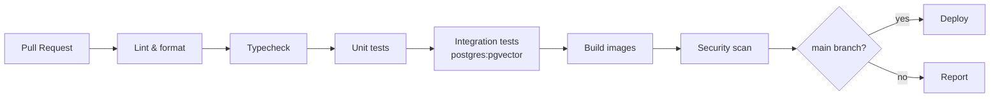

# Repository Structure

**Project:** AI-Powered Developer Portfolio
**Document status:** Draft v0.1 — Phase 1 (target structure; not yet implemented)
**Last updated:** 2026-11-11

---

## 1. Monorepo layout

One repository containing the frontend, backend, infrastructure, and documentation. This keeps
contracts (OpenAPI, DB migrations, env) and deploy config co-located. Application code is **not**
created in Phase 1; this document is the blueprint for Phase 2+.

```text
rajan-portfolio/
├── frontend/                     # React + Vite + TypeScript SPA
│   ├── public/
│   ├── src/
│   │   ├── app/                  # app root, providers, router
│   │   ├── routes/               # route-level pages (public + admin)
│   │   │   ├── public/           # home, projects, project detail, about, contact
│   │   │   └── admin/            # dashboard, content, kb, users, settings
│   │   ├── features/             # feature modules
│   │   │   ├── portfolio/
│   │   │   ├── assistant/
│   │   │   ├── auth/
│   │   │   ├── projects/
│   │   │   ├── skills/
│   │   │   ├── knowledge-base/
│   │   │   ├── users-rbac/
│   │   │   ├── media/
│   │   │   ├── contact/
│   │   │   └── settings/
│   │   ├── components/           # shared UI primitives + layout
│   │   ├── hooks/
│   │   ├── lib/                  # api client, sse, utils, config
│   │   ├── stores/               # client state
│   │   ├── styles/
│   │   └── types/                # generated + shared types
│   ├── tests/                    # unit + component + e2e hooks
│   ├── index.html
│   ├── vite.config.ts
│   ├── tsconfig.json
│   ├── eslint.config.js
│   ├── package.json
│   └── README.md
│
├── backend/                      # Python + FastAPI
│   ├── app/
│   │   ├── main.py               # app factory, middleware, router mounting
│   │   ├── core/                 # config, security, logging, errors, deps
│   │   ├── db/                   # engine, session, base, seed
│   │   ├── models/               # SQLAlchemy ORM models
│   │   ├── schemas/              # Pydantic request/response models
│   │   ├── repositories/         # data-access layer
│   │   ├── services/             # business logic
│   │   ├── api/
│   │   │   └── v1/
│   │   │       ├── routers/      # auth, users, profile, projects, ...
│   │   │       └── dependencies.py
│   │   ├── ai/                   # LLM provider abstraction, prompting, retrieval
│   │   ├── workers/              # indexing/embedding background jobs
│   │   └── cli/                  # management commands (bootstrap super-admin, reindex)
│   ├── alembic/
│   │   ├── versions/
│   │   └── env.py
│   ├── tests/
│   │   ├── unit/
│   │   ├── integration/
│   │   └── fixtures/
│   ├── pyproject.toml
│   ├── alembic.ini
│   ├── Dockerfile
│   └── README.md
│
├── infrastructure/
│   ├── docker/
│   │   ├── docker-compose.yml            # app services (backend, frontend)
│   │   ├── docker-compose.dev.yml        # dev overrides (hot reload, ports)
│   │   ├── postgres/                     # init scripts (extensions)
│   │   └── nginx/                        # reverse proxy config
│   ├── env/
│   │   ├── .env.development.example
│   │   └── .env.production.example
│   ├── deploy/                          # IaC / platform manifests (TBD)
│   └── README.md
│
├── docs/
│   ├── README.md                        # docs index
│   ├── SRS.md
│   ├── architecture.md
│   ├── database.md
│   ├── api.md
│   ├── authentication-rbac.md
│   ├── repository-structure.md
│   ├── security.md
│   ├── milestones.md
│   ├── open-questions.md
│   └── adr/                             # Architecture Decision Records
│       ├── 0001-modular-monolith.md
│       └── template.md
│
├── .github/
│   ├── workflows/
│   │   ├── ci.yml                       # lint, typecheck, test, build
│   │   ├── security.yml                 # dependency/container scanning
│   │   └── deploy.yml                   # build & deploy images (later phase)
│   ├── ISSUE_TEMPLATE/
│   └── pull_request_template.md
│
├── .dockerignore
├── .editorconfig
├── .env.example
├── .gitignore
├── .gitattributes
├── LICENSE
└── README.md
```

---

## 2. Naming conventions

| Area | Convention | Example |
|------|-----------|---------|
| React components | PascalCase files + named exports | `ProjectCard.tsx` |
| Hooks | `use` prefix, camelCase | `useChatStream.ts` |
| Python modules | snake_case | `knowledge_service.py` |
| Python classes | PascalCase | `KnowledgeDocument` |
| DB tables | snake_case plural | `knowledge_documents` |
| Env vars | SCREAMING_SNAKE_CASE | `DATABASE_URL` |
| API paths | kebab-case, plural nouns | `/knowledge/documents` |
| Branches | `type/short-description` | `feat/ai-assistant` |
| Commits | Conventional Commits | `feat(api): add reindex endpoint` |

---

## 3. Frontend organization

- **Feature-first**: each feature owns its components, hooks, API calls, and types; shared
  primitives live in `components/`.
- Public and admin routes are separated at the top level to make code-splitting and auth
  boundaries obvious.
- API access centralized in `lib/api` with a typed client generated from OpenAPI.
- No business/authorization logic in the client; guards are UX only.
- The assistant widget is a self-contained feature mounted at the app shell level so it is
  available on every public page.

---

## 4. Backend organization

- **Layer discipline**: routers → services → repositories → models. Routers never query the
  DB directly; services never depend on HTTP types.
- One router per domain under `api/v1/routers/`, mounted in `api/v1/__init__.py`.
- Pydantic schemas split by intent (`*Create`, `*Update`, `*Read`, `*List`).
- `ai/` holds provider-agnostic interfaces (`EmbeddingProvider`, `ChatProvider`) so vendors can
  be swapped without touching domain code.
- `workers/` implements indexing jobs behind an interface that can move to a queue later.
- `cli/` provides operational commands (bootstrap admin, reindex, purge transcripts).

---

## 5. Configuration & secrets

- `.env.example` (root) documents all variables; actual `.env` is git-ignored.
- Backend validates config at startup and fails fast on missing required values.
- Frontend only receives `VITE_*` public variables; no secrets in the bundle.
- Environment-specific files live under `infrastructure/env/` (examples only).
- Production secrets come from the platform secret manager, not files in the repo.

---

## 6. Docker & infrastructure

- `backend/Dockerfile` (multi-stage, non-root user) and `frontend/Dockerfile` (build + static
  serve via nginx) are self-contained.
- `infrastructure/docker/docker-compose.yml` wires backend, frontend, postgres (pgvector
  image), and redis; dev overrides add hot reload and exposed ports.
- Nginx config handles TLS termination (prod), static caching, and SSE proxy settings
  (buffering off for `/api/v1/chat`).
- `.dockerignore` excludes `node_modules`, `.venv`, caches, and docs where appropriate.

---

## 7. Testing layout

| Layer | Location | Tooling (proposed) |
|-------|----------|--------------------|
| Backend unit | `backend/tests/unit` | pytest |
| Backend integration | `backend/tests/integration` | pytest + test DB (pgvector) |
| Frontend unit/component | `frontend/tests` | Vitest + Testing Library |
| End-to-end | `frontend/tests/e2e` | Playwright |
| Contract | CI | OpenAPI schema diff |

---

## 8. CI/CD (proposed)



- Required checks: lint, typecheck, tests, migration check, build.
- Security workflow: dependency audit + container image scan (Trivy/Grype) + secret scan.
- Deploy workflow is added in a later phase once the hosting target is decided.

---

## 9. Branching & workflow

- Trunk-based with short-lived branches; squash merge to `main`.
- Conventional Commits; PR template with checklist (tests, migrations, security, docs).
- Protect `main`: required reviews + status checks.
- Tag releases `vX.Y.Z`; changelog generated from commits.

---

## 10. Documentation conventions

- All design docs live in `docs/` and are versioned with the code.
- Significant decisions recorded as ADRs (`docs/adr/NNNN-title.md`).
- Diagrams authored in Mermaid so they render in GitHub and stay reviewable in diffs.
- `docs/README.md` is the index and links every document.

---

## 11. Notes / open items

- Confirm whether admin dashboard is part of the same SPA build or a separate app.
- Confirm hosting platform (affects `infrastructure/deploy/`).
- Confirm queue choice (in-process vs Redis-backed) before implementing workers.
