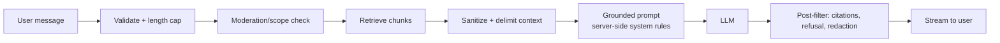

# Security Requirements

**Project:** AI-Powered Developer Portfolio
**Document status:** Draft v0.1 — Phase 1
**Last updated:** 2026-11-11

Security is a first-class requirement, not a hardening pass. This document defines the baseline
controls the implementation must satisfy. Requirements use `SEC-<area>-<n>` IDs for traceability.

---

## 1. Principles

1. **Least privilege** — every user, service, and token gets the minimum access required.
2. **Defense in depth** — no single control is trusted alone.
3. **Secure defaults** — deny by default; opt-in to exposure, encryption, and permissions.
4. **Fail safe** — on error, deny/close; never leak internals or secrets.
5. **Validate at boundaries** — treat all client input, uploaded files, and retrieved AI
   context as untrusted.
6. **No secrets in code or logs** — configuration via environment/secret manager.
7. **Auditability** — privileged actions are attributable and immutable.

---

## 2. Authentication & session security

| ID | Requirement |
|----|-------------|
| SEC-AUTH-01 | Passwords hashed with Argon2id (memory ≥ 64 MiB, iterations ≥ 3). Never reversible storage. |
| SEC-AUTH-02 | Access tokens are short-lived JWTs (≤ 15 min) with pinned algorithm; reject `none`/mismatched alg. |
| SEC-AUTH-03 | Refresh tokens are opaque, high-entropy, stored hashed, rotated on use, with reuse detection. |
| SEC-AUTH-04 | Refresh cookies are `HttpOnly; Secure; SameSite` and scoped to the auth path. |
| SEC-AUTH-05 | Login is rate-limited and locks out after N failures without revealing account existence. |
| SEC-AUTH-06 | No public registration; super-admin bootstrap is CLI/env-driven and one-time. |
| SEC-AUTH-07 | Global logout increments a token version to invalidate outstanding access tokens. |
| SEC-AUTH-08 | Password change requires the current password and revokes other sessions. |
| SEC-AUTH-09 | Admin sessions expire; idle and absolute lifetimes enforced server-side. |
| SEC-AUTH-10 | MFA is required before public production launch **if** owner approves (see open questions). |

See [`authentication-rbac.md`](./authentication-rbac.md) for the full design.

---

## 3. Authorization

| ID | Requirement |
|----|-------------|
| SEC-AUTHZ-01 | RBAC enforced server-side on every protected endpoint (deny by default). |
| SEC-AUTHZ-02 | Effective permissions are computed from roles; no client-supplied permission trust. |
| SEC-AUTHZ-03 | Object-level authorization enforced for sessions, transcripts, and user resources. |
| SEC-AUTHZ-04 | Only super-admins may grant/revoke `super_admin`; last super-admin protected. |
| SEC-AUTHZ-05 | Service/worker identities use scoped credentials, not superuser DB roles. |
| SEC-AUTHZ-06 | Frontend guards are UX-only; never treated as a security boundary. |

---

## 4. Input/output & application security

| ID | Requirement |
|----|-------------|
| SEC-APP-01 | Validate all input with strict schemas; reject unknown/oversized fields. |
| SEC-APP-02 | Prevent SQL injection via parameterized queries/ORM; no string-built SQL. |
| SEC-APP-03 | Prevent XSS: output-encode, sanitize rendered markdown, strict CSP. |
| SEC-APP-04 | Enforce URL scheme allowlists for social/project links (`http`, `https`, `mailto`). |
| SEC-APP-05 | Enforce request/body size limits and pagination caps to prevent resource exhaustion. |
| SEC-APP-06 | Reject or normalize dangerous uploads; validate MIME by content, not extension alone. |
| SEC-APP-07 | Set security headers: CSP, HSTS, `X-Content-Type-Options`, `Referrer-Policy`, `X-Frame-Options`/`frame-ancestors`. |
| SEC-APP-08 | CORS allowlist only; no wildcard with credentials. |
| SEC-APP-09 | Return generic errors publicly; detailed diagnostics only in server logs. |
| SEC-APP-10 | Disable/secure interactive API docs (`/docs`) in production. |

---

## 5. AI / LLM security

| ID | Requirement |
|----|-------------|
| SEC-AI-01 | Treat retrieved knowledge and user messages as untrusted data, never as instructions. |
| SEC-AI-02 | System prompt and guardrails are server-side and not user-editable via API. |
| SEC-AI-03 | No secrets, credentials, or internal URLs in any prompt or context. |
| SEC-AI-04 | Assistant has no tool execution / DB write / network access by default. |
| SEC-AI-05 | Ground answers to retrieved chunks; refuse when confidence is insufficient. |
| SEC-AI-06 | Strip/escape source content before inclusion in prompts and citations. |
| SEC-AI-07 | Enforce per-session and per-IP rate limits, message length caps, and token budgets. |
| SEC-AI-08 | Log prompt/response metrics without storing unnecessary PII; redact sensitive data. |
| SEC-AI-09 | Validate emb/id provider responses; timeout and fail closed for retrieval. |
| SEC-AI-10 | Provide a kill switch to disable the assistant without taking down the site. |
| SEC-AI-11 | Review KB ingestion to prevent publishing sensitive documents to the assistant. |
| SEC-AI-12 | Document and test prompt-injection cases as part of the evaluation set. |

### 5.1 Prompt-injection defense summary

Controls: delimited context blocks, explicit "data not instructions" system rules, no tools,
output post-filtering, and evaluation tests for injection/leak attempts.

---

## 6. Data protection

| ID | Requirement |
|----|-------------|
| SEC-DATA-01 | Encrypt in transit (TLS 1.2+, HSTS) and at rest (managed DB/storage encryption). |
| SEC-DATA-02 | Minimize PII collected (contact + auth only); document retention per data type. |
| SEC-DATA-03 | Never log passwords, tokens, secrets, or full message bodies by default. |
| SEC-DATA-04 | Store refresh tokens hashed; never expose them via API responses. |
| SEC-DATA-05 | Backups encrypted and access-restricted; restore tested periodically. |
| SEC-DATA-06 | Purge expired tokens/transcripts per retention policy via scheduled jobs. |
| SEC-DATA-07 | Support owner/visitor data requests (export/delete) for applicable data. |

---

## 7. Secrets & configuration

| ID | Requirement |
|----|-------------|
| SEC-SEC-01 | Secrets only via environment variables or a secret manager; `.env` git-ignored. |
| SEC-SEC-02 | `.env.example` contains placeholders only, never real values. |
| SEC-SEC-03 | Fail fast at startup on missing/weak required secrets. |
| SEC-SEC-04 | Rotate signing keys and provider API keys on a defined schedule and on suspicion. |
| SEC-SEC-05 | Distinct secrets per environment (dev/staging/prod). |
| SEC-SEC-06 | Frontend bundle contains no secrets; only `VITE_*` public config. |
| SEC-SEC-07 | Secret scanning in CI (e.g., gitleaks) blocks commits with detected credentials. |

---

## 8. Infrastructure & operations

| ID | Requirement |
|----|-------------|
| SEC-INF-01 | Containers run as non-root, read-only FS where possible, minimal base images. |
| SEC-INF-02 | DB and Redis not publicly exposed; private network only. |
| SEC-INF-03 | DB uses a least-privilege application role; migrations use a separate role. |
| SEC-INF-04 | TLS terminated at a trusted proxy; internal traffic on private network. |
| SEC-INF-05 | Dependency and container image scanning on every build. |
| SEC-INF-06 | Automated backups with encryption and tested restore procedure. |
| SEC-INF-07 | Health/readiness endpoints expose no sensitive internals. |
| SEC-INF-08 | Environment parity; production debug/reload disabled. |
| SEC-INF-09 | Least-privilege CI credentials; no long-lived cloud keys where OIDC is available. |

---

## 9. Logging, monitoring & incident response

| ID | Requirement |
|----|-------------|
| SEC-LOG-01 | Structured logs with request IDs; never log secrets/tokens/passwords. |
| SEC-LOG-02 | Security events (auth failures, lockouts, reuse detection, privilege changes) logged. |
| SEC-LOG-03 | Audit log is append-only and access-restricted. |
| SEC-LOG-04 | Alerting on auth anomalies, error spikes, and assistant abuse/rate-limit surges. |
| SEC-LOG-05 | Documented incident response: detect → contain → eradicate → recover → review. |
| SEC-LOG-06 | Retain security logs ≥ 90 days (audit logs 12–24 months). |

---

## 10. Privacy & compliance considerations

- Publish a privacy notice covering contact data, chat transcripts, and analytics.
- Collect only what is needed; provide a contact/removal path.
- If analytics are added, prefer privacy-preserving, cookie-light tooling; honor consent.
- Do not send unnecessary personal data to third-party LLM providers; configure provider data
  retention/opt-out where available.
- Document data residency for DB, storage, and LLM providers.

---

## 11. OWASP Top 10 (2021) mapping

| Risk | Controls |
|------|----------|
| A01 Broken Access Control | Server-side RBAC, object-level checks, deny-by-default, last-admin protection. |
| A02 Cryptographic Failures | TLS/HSTS, Argon2id, hashed refresh tokens, encrypted backups, no secrets in code. |
| A03 Injection | ORM/parameterized SQL, schema validation, output encoding, markdown sanitization. |
| A04 Insecure Design | Threat modeling, rate limits, grounding rules, secure defaults. |
| A05 Security Misconfiguration | Hardened containers, security headers, CORS allowlist, docs disabled in prod. |
| A06 Vulnerable Components | Lockfiles, dependency audit, image scanning in CI, regular updates. |
| A07 Auth Failures | Rotation + reuse detection, lockout, short tokens, no enumeration. |
| A08 Data Integrity Failures | Signed builds, pinned deps, CI provenance, migration review. |
| A09 Logging/Monitoring Failures | Structured logs, audit trail, alerting, retention. |
| A10 SSRF | No user-controlled server-side fetches; URL allowlists; KB ingestion restricted to admins. |

---

## 12. OWASP LLM Top 10 mapping (assistant)

| Risk | Controls |
|------|----------|
| LLM01 Prompt Injection | Data/instruction separation, delimited context, no tools, output filtering, eval cases. |
| LLM02 Insecure Output Handling | Escape/sanitize LLM output; never execute or inject as HTML unsafely. |
| LLM03 Training Data Poisoning | Curated KB, admin-only ingestion, review before publish. |
| LLM04 Model DoS | Rate limits, token caps, timeouts, circuit breakers. |
| LLM05 Supply Chain | Pin provider SDKs, audit dependencies, verify images. |
| LLM06 Sensitive Info Disclosure | No secrets in prompts, PII minimization, redaction in logs. |
| LLM07 Insecure Plugin Design | No tools/plugins in MVP. |
| LLM08 Excessive Agency | Read-only assistant; no DB writes or external actions. |
| LLM09 Overreliance | Citations, refusal path, "verify important info" UX. |
| LLM10 Model Theft | No model hosting in MVP; protect provider keys. |

---

## 13. Security testing requirements

- SAST + dependency + secret scanning in CI.
- Authorization tests for every role/permission boundary (positive and negative).
- Auth tests: rotation, reuse detection, lockout, expiry, revoked token rejection.
- Input fuzzing for auth, contact, and knowledge upload endpoints.
- Stored/reflected XSS tests for markdown rendering and project fields.
- Prompt-injection and data-leak test suite for the assistant.
- Pre-release checklist: headers, cookies, CORS, error leakage, docs exposure, rate limits.

---

## 14. Secure SDLC gates

| Gate | Requirement |
|------|-------------|
| Design | Security requirements reviewed; threat model updated. |
| PR | Lint/typecheck/tests pass; no secrets; authz tests included for new endpoints. |
| Build | Dependency + image scan with no unresolved criticals. |
| Deploy | Secrets from manager; TLS + headers verified; migrations reviewed. |
| Operate | Backups verified; alerts configured; incident runbook current. |

---

## 15. Open security questions

See [`open-questions.md`](./open-questions.md). Notable: MFA in MVP, hosting/data residency,
whether to persist chat transcripts, and provider data-retention terms.
